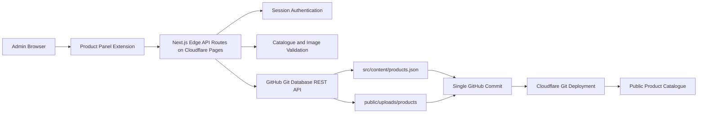

# Nelytech Product Catalogue CMS

The Nelytech Product Catalogue CMS is a custom Git-based content management system built around the existing Product Panel Extension. Product data and product images remain version-controlled in GitHub. Administrators edit the catalogue in a visual interface, and protected Next.js Edge API routes running on Cloudflare Pages validate and commit approved changes to the repository. A successful GitHub commit triggers the normal Cloudflare Git deployment.

This architecture uses:

- No traditional server to operate.
- No application database.
- Cloudflare serverless Edge routes for authentication and publishing.
- GitHub as the versioned source of published catalogue content.

It still contains backend code. The authentication, validation, image processing, and GitHub publishing modules run server-side in the Cloudflare Pages worker generated by `@cloudflare/next-on-pages`.

## Overview

The normal publishing flow is:

```text
Admin visits /admin/login
-> Enters the administrator access key
-> The Cloudflare Edge login route validates the key
-> Admin receives a signed HTTP-only session cookie
-> Admin edits catalogue content under Parent Categories and Subcategories, including products and Product Detail content
-> Changes appear in Live Preview and are retained as a local working draft
-> Admin clicks Submit Changes
-> The publish route authenticates and validates the submission
-> New images and src/content/products.json are committed to GitHub together
-> GitHub triggers a new Cloudflare Pages deployment
-> The public Product Catalogue updates after that deployment succeeds
```

The success dialog says that the site may take approximately two minutes to update. This is an estimate, not a timer or deployment guarantee. The Admin interface does not currently poll Cloudflare for deployment status.

The browser draft by itself never changes the public website. Publishing starts only after the GitHub commit succeeds.

## Architecture

### Implementation baseline

| Concern | Current implementation |
| --- | --- |
| Frontend framework | Next.js 15 App Router with React 19 |
| Language | TypeScript 6 |
| Styling | Tailwind CSS 4 |
| Standard application build | Next.js through `npm run build` |
| Cloudflare adapter | `@cloudflare/next-on-pages` through `npm run pages:build` |
| Package manager | npm with `package-lock.json` |
| Deployment platform | Cloudflare Pages with Git integration |
| Production publishing branch | `main` unless `GITHUB_BRANCH` is changed |



### System layers

| Layer | Responsibility |
| --- | --- |
| Public Product Catalogue | Renders `/products`, category pages, search, filters, product cards, and Product Detail pages from the canonical JSON imported at build time. |
| Product Panel Extension | Provides the English-only catalogue hierarchy, product-card editor, Product Detail editor, Live Preview, local draft persistence, and Submit Changes action. |
| Authentication Edge routes | Validate the Admin Key, issue and verify the signed session cookie, and log the administrator out. |
| Publishing Edge route | Authenticates the request, checks its origin and size, validates data and images, serializes canonical JSON, and invokes the GitHub client. |
| GitHub repository | Stores catalogue JSON, uploaded images, and the complete history of successful publishing commits. |
| Cloudflare Pages | Builds the Git-connected production branch and serves the static assets plus the generated Edge worker. |

There is no repository-level `functions/` directory. The actual server endpoints are Next.js App Router route handlers under `src/app/api/admin`. They export `runtime = "edge"` and are included in the Cloudflare Pages worker by `@cloudflare/next-on-pages`.

### Runtime routes

Admin pages:

| Route | Purpose |
| --- | --- |
| `/admin/login` | Administrator access-key form. |
| `/admin/catalogue` | Product Catalogue hierarchy and Subcategory management. |
| `/admin/catalogue/[subcategorySlug]` | Product-card editor and Live Preview. The parameter may also be a Parent Category slug. |
| `/admin/catalogue/[subcategorySlug]/[productSlug]` | Product Detail editor and preview. |

Protected API routes:

| Method and route | Purpose |
| --- | --- |
| `POST /api/admin/login` | Validate the Admin Key and create a session. |
| `GET /api/admin/session` | Check and refresh the client-side understanding of session state. |
| `POST /api/admin/logout` | Expire the session cookie. |
| `POST /api/admin/publish` | Validate and commit catalogue changes and new images. |

The Admin page guard improves navigation behavior, but it is not the security boundary. The publish API verifies the signed session independently on every request.

## Why a Git-based CMS?

### Benefits

- There is no product database to provision, migrate, back up, or monitor.
- Product data remains part of the codebase and is reviewed with the website.
- Every successful publication creates Git history with a commit SHA.
- The existing Git-connected Cloudflare deployment rebuilds the site automatically.
- A previous catalogue can be restored with an ordinary Git revert.
- Infrastructure remains small: Cloudflare Pages, Edge routes, and GitHub.
- The model fits a relatively small, curated B2B product catalogue.
- The custom Product Panel Extension and its Live Preview remain under project control.

### Trade-offs

- Each publication requires both a GitHub commit and a successful deployment.
- Changes are not instant like database-backed content updates.
- Repository-hosted media increases repository size; a large library may belong in Cloudflare R2 later.
- Concurrent editing has conflict checks but no record locking or merge UI.
- GitHub API rate limits, token availability, and repository size affect publishing.
- One shared Admin Key cannot identify individual administrators.
- This approach is not suited to high-frequency content changes.

## Catalogue Data Model

The canonical source is:

```text
src/content/products.json
```

`src/content/catalogue.ts` imports that JSON and exposes it as `canonicalCatalogue`. Public catalogue configuration, Product Detail data, Admin draft creation, and Parent Category Filter Schemas derive from this object.

The top-level structure contains:

```text
Catalogue
-> allProducts metadata
-> Parent Categories
   -> direct Products
   -> Subcategories
      -> Products
         -> Product Card data
         -> Product Detail data
-> Parent Category Filter Schemas
-> updatedAt
```

Products do not store separate `parentCategoryId` and `subcategoryId` fields. Their owner is determined by where they are nested in the Parent Category or Subcategory product array. A Subcategory does store `parentCategoryId` and publishing validates that relationship.

A simplified object matching the current schema looks like this:

```json
{
  "version": 1,
  "categories": [
    {
      "id": "category-lcd-panels",
      "slug": "lcd-panels",
      "name": "LCD Panels",
      "description": "Core monochrome LCD panel technologies.",
      "route": "/products/lcd-panels",
      "products": [],
      "subcategories": [
        {
          "id": "subcategory-tn",
          "slug": "tn",
          "name": "TN (Twisted Nematic)",
          "description": "TN display products.",
          "parentCategoryId": "category-lcd-panels",
          "products": [
            {
              "id": "product-id",
              "partNumber": "NLY-EXAMPLE-01",
              "slug": "example-display",
              "name": "Example Display",
              "description": "A compact display for clocks and counters.",
              "image": "/uploads/products/example-display/cover-a1b2c3.webp",
              "imageAlt": "Front view of the example display",
              "specs": [],
              "filters": {
                "application": ["counters"],
                "interface": ["glass-only"],
                "format": ["numeric"]
              },
              "detail": {
                "introduction": "A compact display designed for numeric output.",
                "images": [],
                "summary": [],
                "specifications": [],
                "descriptionParagraphs": [],
                "applications": [],
                "optionGroups": [],
                "downloads": []
              }
            }
          ]
        }
      ]
    }
  ],
  "filterSchemas": {}
}
```

Product Detail fields are optional in the editor, but the containing lists are normalized and serialized consistently. Product-card fields required by the current UI include the name, short description, cover image, image alt text, generated slug, and every required Filter Group. The server also requires a stable product ID, part number, valid slug, and valid image source.

Admin-only fields such as `isDraft`, `previewImage`, and `previewSrc` are not included by the explicit server serializer. Empty editor guidance is not canonical data. Exact placeholder phrases, secret-like field names, and final `blob:`, `data:`, or `upload:` image references are rejected during server validation.

## Filter Schema Architecture

Filter Schemas are stored in `filterSchemas` inside `src/content/products.json` and exposed through `src/data/categoryFilterSchemas.ts`.

```text
One Parent Category
-> One shared Filter Schema

Every Subcategory under that Parent Category
-> Resolves and inherits the same Filter Groups, option IDs, labels, order,
   selection mode, and required flags
```

Products store stable Filter Group IDs and Filter Option IDs. Visible labels are not relationships and may be revised without changing stored selections. Do not rename IDs casually.

Actual examples:

- TN and HTN are children of LCD Panels and inherit the `lcd-panels` Filter Schema.
- COG is a child of Assembly Technologies and inherits the `assembly-technologies` Filter Schema.
- COG does **not** inherit the LCD Panels schema in the current hierarchy.
- The `all` schema is used by the aggregate All Products view.

Parent pages aggregate direct products and child products. Child pages use only products in that child, so counts can differ even though sibling pages expose the same schema and option order.

On the public Product Catalogue, zero-result options are disabled unless already selected. Empty Subcategories still display their inherited schema with zero counts. In the Product Panel Extension, zero-result options remain enabled so the first product in an empty Subcategory can be classified.

The Admin editor and public filtering utilities both read the same canonical schemas. A Subcategory-specific schema is invalid and is rejected during publishing.

## Product Panel Extension

The Product Panel Extension is the custom Admin editing experience under `/admin/catalogue`.

### Implemented behavior

- English-only login and Admin interface.
- English-only category, product, Product Detail, image-alt, and Filter Option content rules.
- Catalogue hierarchy grouped by Parent Category.
- Add and delete Subcategories in the working draft.
- Add, edit, and delete products.
- Edit product name, concise card description, cover image, image alt text, and filter selections.
- Edit optional Product Detail summary, gallery, product information, specifications, description paragraphs, applications, options, and downloads.
- Live Preview built from the same public catalogue components and filter utilities.
- Shared draft state across all Product Panel Extension routes.
- Local draft persistence in browser `localStorage` under namespaced keys.
- A fixed Submit Changes action with saving, error, and success states.
- Draft preservation when validation, authentication, GitHub, or persistence fails.
- A success dialog only after the protected publish request succeeds.

The raw Admin Key is never stored in `localStorage` or `sessionStorage`. Catalogue draft content and the last successful commit SHA are stored locally so internal navigation and refreshes can restore the working state.

### Navigation and unsaved changes

Internal movement between hierarchy, product-card, and Product Detail routes does not show the custom unsaved-exit warning. The shared provider keeps the draft available across those routes. Browser refresh and tab close use the browser's `beforeunload` protection while dirty.

The custom warning is attached to global header and footer links that leave the Product Panel Extension. It offers these choices:

- Stay in the editor.
- Leave without saving and restore the most recently submitted local draft.
- Submit Changes and continue only if publication succeeds.

Non-header Live Preview links do not open the custom warning. The draft is still persisted locally.

### Five-Subcategory display rule

The first five Subcategories in a Parent Category are rendered directly. Any additional Subcategories are placed in the three-dot overflow panel. The panel supports hover, click/touch, keyboard focus, Escape, outside click, and viewport-aware positioning.

This is presentation only. Moving an item into the overflow does not delete or alter its data. When a visible item is deleted, the next overflow item is promoted automatically.

### Planned

- Renaming or editing the metadata of an existing Subcategory in the Admin UI.
- Adding, renaming, reordering, or deleting Parent Categories in the Admin UI.
- Editing Parent Category Filter Schemas in the Admin UI.

These changes can currently be made only by a developer through the canonical JSON and code review.

## Authentication and Sessions

Authentication uses three Edge routes:

```text
POST /api/admin/login
GET  /api/admin/session
POST /api/admin/logout
```

The login form sends a JSON body containing the access key over the same origin. The server rejects mismatched origins, non-JSON requests, bodies over 2,048 bytes, and keys over 256 characters. Login errors are intentionally generic.

The server reads `ADMIN_KEY` and `SESSION_SECRET` from Cloudflare bindings. It compares SHA-256 digests in constant time. A successful login creates a signed session with:

- Role: `admin`.
- Issued-at and expiry timestamps.
- A random nonce.
- HMAC-SHA-256 signature using `SESSION_SECRET`.
- Four-hour maximum duration (`14,400` seconds).

The browser receives the `nelytech_admin_session` cookie. It contains signed session data, not the raw Admin Key.

Cookie properties:

| Property | Current behavior |
| --- | --- |
| `HttpOnly` | Always set; browser JavaScript cannot read the cookie. |
| `Secure` | Set for HTTPS requests; intentionally omitted for local HTTP development. |
| `SameSite` | `Strict`. |
| `Path` | `/`. |
| Expiration | Active cookie uses `Max-Age=14400`; the signed payload has the same maximum lifetime. Logout also sets `Max-Age=0` and an epoch `Expires` value. |

`GET /api/admin/session` verifies the signature and expiry. An invalid session receives `{ "authenticated": false }` and an expired cookie. `POST /api/admin/logout` expires the cookie. `POST /api/admin/publish` performs its own session verification before parsing the catalogue body.

Do not put the Admin Key in a `NEXT_PUBLIC_*`, `VITE_*`, or any other browser-exposed variable. Do not store it in browser storage.

> Never commit the Admin Key, GitHub token, or session secret to the repository.

## Environment Variables

The implementation reads these server-side bindings:

| Variable | Required | Type | Purpose | Example format |
| --- | --- | --- | --- | --- |
| `ADMIN_KEY` | Yes | Secret | Validates Admin login. | `replace-with-a-secure-admin-key` |
| `SESSION_SECRET` | Yes | Secret | Signs Admin session tokens; must be at least 32 characters. | `replace-with-a-long-random-secret` |
| `GITHUB_TOKEN` | Yes for real publishing | Secret | Authenticates GitHub Git Database API requests. | `<fine-grained-token>` |
| `GITHUB_OWNER` | Yes | Regular variable | GitHub account or organization that owns the repository. | `<github-owner>` |
| `GITHUB_REPO` | Yes | Regular variable | Repository name. | `<repository-name>` |
| `GITHUB_BRANCH` | Recommended | Regular variable | Branch updated by Submit Changes; defaults to `main`. | `<production-branch>` |
| `PRODUCTS_FILE_PATH` | Recommended | Regular variable | Repository path written by the publisher; defaults to `src/content/products.json`. | `src/content/products.json` |
| `PRODUCT_IMAGES_PATH` | Recommended | Regular variable | Repository directory for new product images; defaults to `public/uploads/products`. | `public/uploads/products` |
| `E2E_GITHUB_MOCK_MODE` | Test only | Regular variable | Selects `success`, `failure`, or `conflict` without calling GitHub. | `success` |

Never set `E2E_GITHUB_MOCK_MODE` in production. It is an automated-testing and local-development switch, not a production fallback.

### Production and preview

Configure Secrets and regular variables in the Cloudflare Pages project for each environment that should support Admin publishing. Production and preview settings are separate. Use encrypted Cloudflare Secrets for `ADMIN_KEY`, `SESSION_SECRET`, and `GITHUB_TOKEN`; use regular server-side variables for the repository and path settings.

The repository has no `wrangler.toml` or `wrangler.json`. Cloudflare Pages project settings are currently managed in the Cloudflare Dashboard, not committed as infrastructure configuration.

### Local variables

`.dev.vars.example` contains safe placeholders and expected variable names. Create an untracked `.dev.vars` for local values. Both `.dev.vars` and the local `.wrangler/` state directory are ignored by Git.

`next.config.ts` calls `setupDevPlatform()` in development. As a result, `npm run dev` loads the Cloudflare development bindings from `.dev.vars` for these Edge routes. There is no separate Wrangler development script in `package.json`.

## GitHub Repository Access

Use a fine-grained GitHub Personal Access Token rather than a classic token:

1. In GitHub, open Settings -> Developer settings -> Personal access tokens -> Fine-grained tokens.
2. Select the correct resource owner.
3. Restrict repository access to only the Nelytech repository.
4. Set Repository permissions -> Contents to Read and write.
5. Do not grant Workflow, Administration, Issues, or other unrelated permissions.
6. Set an expiration date and record the rotation owner and date outside the repository.
7. Store the token only in the Cloudflare `GITHUB_TOKEN` Secret or an untracked local `.dev.vars`.

Fine-grained tokens are preferred because they can be limited to one repository, one resource owner, selected permissions, and a defined lifetime. The Git Database endpoints used by this project require repository content write access. See GitHub's [fine-grained token management guide](https://docs.github.com/en/authentication/keeping-your-account-and-data-secure/managing-your-personal-access-tokens) and [REST permission reference](https://docs.github.com/en/rest/authentication/permissions-required-for-fine-grained-personal-access-tokens).

If the token is expired, revoked, limited to the wrong repository, or lacks Contents write permission, publication returns a sanitized GitHub failure to the browser. Raw GitHub response bodies are not forwarded.

## Local Development Setup

Prerequisites:

- Node.js 20 or newer, as required by `package.json`.
- npm; `package-lock.json` is the tracked lockfile.
- Git access to the repository.

Install and start the project:

```bash
git clone https://github.com/Jeff-zhang921/nelytech.git
cd nelytech
npm install
```

Create local server bindings:

```bash
cp .dev.vars.example .dev.vars
```

On PowerShell, use:

```powershell
Copy-Item .dev.vars.example .dev.vars
```

Replace placeholders only in `.dev.vars`. Generate a session secret with:

```bash
node -e "console.log(require('crypto').randomBytes(48).toString('base64url'))"
```

Start the integrated Next.js and Cloudflare development environment:

```bash
npm run dev
```

Open:

```text
http://localhost:3000/admin/login
```

`npm run dev` is sufficient in this repository because `next.config.ts` invokes `setupDevPlatform()` during development. Do not start a second Wrangler server on the same port.

### Local verification

1. Sign in with the local placeholder replacement for `ADMIN_KEY`.
2. Refresh an Admin page and confirm the session remains active.
3. Edit a product and move between Admin routes; the draft should remain.
4. Confirm Live Preview updates.
5. For a no-GitHub test, temporarily set `E2E_GITHUB_MOCK_MODE=success` in `.dev.vars`, restart the development server, and use Submit Changes.
6. Remove the mock setting before testing a real GitHub commit.

For a real development publish, use a dedicated test branch and an appropriately scoped token. Do not test publishing against the production branch unless the change is intended for production.

## Publishing Workflow

1. The administrator edits the local `CatalogueDraft`.
2. The shared provider writes the draft to namespaced browser `localStorage` and updates Live Preview.
3. Submit Changes clones and normalizes the draft, runs client validation, and prevents duplicate submissions.
4. New data-URL images are converted to `File` objects and represented temporarily by `upload:<id>` markers in the request draft.
5. The browser sends JSON when there are no new images or multipart form data when there are uploads.
6. `POST /api/admin/publish` verifies the signed session before parsing the submission.
7. The route rejects a mismatched Origin and enforces request-size and content-type rules.
8. Image metadata, ownership, type, bytes, size, filename, and destination are validated. Temporary markers are replaced with public paths.
9. Catalogue validation checks hierarchy, IDs, slugs, English content, routes, filters, Product Detail lists, image paths, placeholders, and secret-like fields.
10. The serializer trims and orders data, removes Admin-only fields, writes `updatedAt`, and produces deterministic two-space JSON with a final newline.
11. The GitHub client reads the current branch head and its base tree.
12. It creates one Git blob for `PRODUCTS_FILE_PATH` and one blob for each new image.
13. It creates a new Git tree and one commit with the current head as its parent.
14. It reads the branch head again. A changed head produces a conflict instead of overwriting newer work.
15. It updates the branch reference with `force: false`.
16. GitHub triggers the connected Cloudflare Pages deployment.
17. The success dialog reports that the commit succeeded and that deployment may take approximately two minutes.

The Git commit message is currently:

```text
content(catalogue): update products from admin editor
```

On success, the API returns the new commit SHA, previous commit SHA, commit URL, publication timestamp, and image-path replacements. The browser marks the local draft as published only after receiving that response.

On any failure, the working draft remains available. A `409 GITHUB_CONFLICT` specifically instructs the administrator to reload the latest published data before trying again.

## Product Image Handling

The current editor reads selected files as temporary browser data URLs for Live Preview. Existing published images may be local public paths or HTTP/HTTPS sources. Temporary `blob:`, `data:`, and `upload:` references are not valid in final canonical JSON.

During publication:

- New images are sent as multipart file fields rather than embedded in JSON.
- Each upload is tied to a product ID, product slug, and cover or Product Detail target.
- The server verifies that the target exists and that the upload marker matches it.
- A collision-resistant 12-character UUID fragment is added to each repository filename.
- The repository path remains under `PRODUCT_IMAGES_PATH` and the product slug.
- The canonical JSON receives the public path with the leading `public/` removed.
- Filename and path traversal are rejected.
- MIME type, generated extension, and file magic bytes must agree.

Example repository and public paths:

```text
public/uploads/products/example-display/cover-a1b2c3d4e5f6.webp
/uploads/products/example-display/cover-a1b2c3d4e5f6.webp
```

Current restrictions:

| Restriction | Value |
| --- | --- |
| Accepted formats | JPEG/JPG, PNG, WebP |
| UI per-image limit | 1,500,000 bytes |
| Server per-image limit | 1.5 MiB |
| New images per submission | 30 |
| Total new-image bytes per submission | 24 MiB |
| Complete publish request | 30 MiB |

`public/uploads/products` is the configured target but is not present in the repository yet. The first successful image publication creates files under that path in GitHub. Existing catalogue artwork is currently stored in other public image paths or referenced by remote URLs.

Deleting or replacing a product does not automatically delete older repository images. Review and remove confirmed orphans in a separate Git commit.

## Cloudflare Deployment

The application is deployed as a Cloudflare Pages project connected to GitHub. It is not configured as a standalone Cloudflare Workers with Static Assets project.

Verified repository settings:

| Setting | Value |
| --- | --- |
| Publishing branch | `main` by default and in `.dev.vars.example` |
| Current local branch | `main` at the time this document was written |
| Package manager | npm |
| Node requirement | Node.js 20 or newer |
| Pages build command | `npm run pages:build` |
| Pages output directory | `.vercel/output/static` |
| Framework adapter | `@cloudflare/next-on-pages` |

The Cloudflare production-branch selection and Git connection live in the Cloudflare Dashboard, not in this repository. Confirm that the Pages project is connected to the same repository and that its production branch matches `GITHUB_BRANCH`. Otherwise Submit Changes may commit successfully without triggering the intended production deployment.

There is no npm deploy command. Deployment is Git-triggered:

1. The publisher updates the configured GitHub branch.
2. Cloudflare detects the commit.
3. Cloudflare runs `npm run pages:build` from the repository root.
4. Cloudflare serves `.vercel/output/static` and its generated `_worker.js`.

Configure build settings and variables under the Pages project in Workers & Pages. Cloudflare documents the current dashboard path in [Pages build configuration](https://developers.cloudflare.com/pages/configuration/build-configuration/) and [Pages bindings](https://developers.cloudflare.com/pages/functions/bindings/).

To inspect a failed deployment, open Cloudflare Dashboard -> Workers & Pages -> the Nelytech Pages project -> Deployments -> the failed deployment. Check dependency installation first, then the `pages:build` output and route/runtime errors. Do not change the output directory to a Next.js internal asset folder.

To trigger a fresh deployment safely, push a normal reviewed commit to the connected branch or use the supported retry action for the failed deployment. Never force-push merely to retrigger a build.

## Security Rules

- Never expose `ADMIN_KEY` in `NEXT_PUBLIC_*`, `VITE_*`, frontend source, or response payloads.
- Never expose `GITHUB_TOKEN` or `SESSION_SECRET` to browser code.
- Never commit `.dev.vars`.
- Never store the raw Admin Key in browser storage.
- Never log keys, tokens, cookies, authorization headers, or complete private API responses.
- Never return raw GitHub API response bodies to the browser.
- Publishing requires a valid HMAC-signed Admin session.
- State-changing routes use `isSameOriginRequest`; a mismatched `Origin` returns `403 INVALID_ORIGIN`. The helper accepts non-browser clients that omit `Origin`, so the signed cookie remains the primary authorization requirement.
- `SameSite=Strict` and the origin check reduce cross-site request risk.
- Repository reference updates use `force: false`.
- A branch change during publication produces `409 GITHUB_CONFLICT` instead of overwriting it.
- Catalogue IDs, slugs, repository paths, download URLs, and image paths are validated.
- Product image MIME type and magic bytes are checked.
- Secret-like object keys, Admin placeholders, and temporary image URLs cannot be published.
- Public Product Catalogue content must remain English-only under the current content rules.
- Do not enable `E2E_GITHUB_MOCK_MODE` in Cloudflare production or preview environments used by real administrators.

### If a secret is exposed

1. Revoke the exposed GitHub token immediately.
2. Create a replacement token with the minimum repository permissions and update the Cloudflare Secret.
3. Rotate `ADMIN_KEY`.
4. Rotate `SESSION_SECRET`; this invalidates all current signed sessions.
5. Restart local environments that loaded old `.dev.vars` values and redeploy Cloudflare.
6. Inspect Git history, GitHub audit information, Cloudflare deployment logs, and application logs.
7. If a secret was committed, remove it from current files, revoke it first, and use an approved history-cleaning process. Coordinate any history rewrite with all repository users; do not force-push casually.

## Administrator Guide

1. Open `/admin/login`.
2. Enter the administrator access key and select Sign In.
3. From `/admin/catalogue`, choose a Parent Category or create a Subcategory.
4. Open the Parent Category or Subcategory product editor.
5. Use Manage Products to add, edit, or delete a product.
6. Enter the required English product-card fields.
7. Select the English Filter Options required by the inherited Parent Category Filter Schema.
8. Open the Product Detail editor for optional gallery, summary, product information, description, applications, options, and downloads.
9. Review Live Preview at desktop and mobile widths where practical.
10. Continue moving between Admin pages; internal navigation preserves the draft without the custom exit warning.
11. Select Submit Changes from the persistent bottom action.
12. Correct any validation fields shown by the editor.
13. Wait for the Changes submitted successfully dialog.
14. Allow approximately two minutes for Cloudflare deployment, then verify the public Product Catalogue.

Operational notes:

- Product Detail fields are optional; exact instructional placeholder text is never published.
- Product-card name, short description, cover image, alt text, and required filters must pass validation.
- New products receive a draft part number and empty Product Detail structure automatically. A developer should replace placeholder business identifiers when real product data becomes available.
- Filter selections determine public search/filter behavior; choose them carefully.
- Header or footer links may warn before leaving with unsaved changes.
- Submit Changes means committed to GitHub, not immediately live.

## Developer Maintenance Guide

### Add a Parent Category

Parent Category creation is not implemented in the Admin UI.

1. Add the Parent Category object to `categories` in `src/content/products.json` with a stable ID, unique lowercase slug, valid `/products/<slug>` route, English name/description, direct product list, and Subcategory list.
2. Add exactly one matching entry in `filterSchemas`, keyed by the Parent Category slug.
3. Ensure each Subcategory uses the Parent Category object's stable ID in `parentCategoryId`.
4. Run type checking, lint, Playwright schema tests, and a production build.

### Add or change a Parent Category Filter Schema

Edit only `filterSchemas` in the canonical JSON. Each group needs a stable ID, English label, `single` or `multiple` selection mode, required flag, and stable option IDs/labels. Do not add a schema under a Subcategory slug.

After adding a required group, update every existing product under that Parent Category with at least one valid option before deployment. The server rejects missing required selections.

### Add a Filter Option safely

1. Add a new stable option ID and English label to the owning Parent Category schema.
2. Do not reuse an old ID for a different meaning.
3. Assign that ID to relevant products.
4. Confirm public counts, zero-result behavior, Admin selection, URL query serialization, and sibling inheritance.

### Preserve stable IDs

IDs are relationships and migration keys. Renaming a label is usually safe; changing a group, option, category, Subcategory, Product, or Product Detail item ID can invalidate stored selections, routes, or local drafts. Use an explicit migration when an ID must change.

Do not store visible labels as relationships when stable IDs exist.

### Add a new Admin or Product Detail field

Update all affected boundaries:

1. Types in `src/lib/adminCatalogueDraft.ts` and, if needed, public Product Detail types.
2. Canonical JSON objects.
3. Admin editor controls and Live Preview.
4. `src/server/admin/catalogueValidation.ts`.
5. The explicit serializer in `src/server/admin/catalogueSerializer.ts`.
6. Public derivation in `src/data/productCatalogue.ts` or `src/data/productDetails.ts`.
7. Tests for editing, validation, serialization, and public rendering.

Do not rely on object spreading to publish a new field; the explicit serializer intentionally strips unknown/Admin-only fields.

### Change the canonical product-data path

`PRODUCTS_FILE_PATH` controls the path written in GitHub, but `src/content/catalogue.ts` currently imports `./products.json` directly. Changing only the environment variable would make the publisher update a file that the website does not read.

To move the file safely:

1. Move `src/content/products.json` to the reviewed target.
2. Update the import in `src/content/catalogue.ts`.
3. Set `PRODUCTS_FILE_PATH` to the same repository-relative path in all Cloudflare environments and local `.dev.vars`.
4. Update documentation and tests that reference the path.
5. Publish to a test branch and verify the built site uses the new file.

### Change the product-image path

Set `PRODUCT_IMAGES_PATH` to a sanitized repository-relative path beginning with `public/`. Update every Cloudflare environment. New uploads use the new path; existing JSON references and old files are not moved automatically.

### Rotate GitHub credentials

Create a replacement fine-grained token, update `GITHUB_TOKEN` in production and preview, deploy, perform a controlled test publication, then revoke the previous token. Never place both tokens in source control.

### Update session duration

Change `ADMIN_SESSION_DURATION_SECONDS` in `src/server/admin/adminSession.ts`. Keep the signed payload limit and cookie `Max-Age` aligned, update tests for expiry, and document the new duration. Rotating the duration alone does not revoke already signed sessions unless validation makes them invalid; rotate `SESSION_SECRET` for immediate invalidation.

### Test publishing without production credentials

Use the Playwright configuration or `E2E_GITHUB_MOCK_MODE` with fake test credentials. The implemented values are `success`, `failure`, and `conflict`. Never put a real GitHub token in test files. For end-to-end validation against GitHub, use a disposable branch and a separately scoped token outside committed files.

### Handle schema migrations

There is no automated migration framework.

```text
Planned
```

Until one exists, write a reviewed one-time script or mechanical change that reads the old canonical structure, maps stable IDs explicitly, validates the result, increments `version` when appropriate, and produces deterministic JSON. Back up with tests before deleting migration code.

## Troubleshooting

| Problem | Likely cause | Resolution |
| --- | --- | --- |
| Admin login always fails with `401 INVALID_CREDENTIALS` | Wrong key, malformed body, wrong content type, body too large, or key over 256 characters. | Confirm the correct environment-specific Admin Key and submit through the normal form. The response intentionally does not distinguish causes. |
| Login returns `503 AUTHENTICATION_UNAVAILABLE` | `ADMIN_KEY` is missing, or `SESSION_SECRET` is missing/shorter than 32 characters. | Configure both server-side bindings in the active Cloudflare environment and redeploy. |
| Admin session disappears after refresh | Four-hour expiry, changed `SESSION_SECRET`, cookie blocked, or host/protocol changed. | Check the `nelytech_admin_session` cookie on the same host, use HTTPS in production, and confirm the same session secret is active. Do not expect a localhost cookie to work on a deployed domain. |
| Admin route redirects to login | `GET /api/admin/session` returned unauthenticated or failed. | Check the session endpoint, cookie, deployment bindings, and browser console/network panel. Sign in again after expiry. |
| Submit Changes returns `401 AUTHENTICATION_REQUIRED` | Session is missing, invalid, or expired. | Sign in again. The draft remains in local storage and should be restored. |
| Submit Changes returns `403 INVALID_ORIGIN` | The request `Origin` does not match the request host/protocol, often because of a proxy or mixed domain. | Submit from the same deployed origin. Check forwarded host/protocol settings instead of disabling the check. |
| Submission returns `413 REQUEST_TOO_LARGE` | Complete request exceeds 30 MiB. | Reduce image count or image sizes and submit again. |
| Submission returns `415 UNSUPPORTED_MEDIA_TYPE` | Request is neither JSON nor multipart form data. | Use the Product Panel Extension or match `adminApi.ts` request formatting. |
| Submission returns `422 VALIDATION_FAILED` | Required card data, hierarchy, English content, stable IDs, routes, filters, images, or Product Detail lists are invalid. | Review the returned `fields` paths and messages. Correct the draft; do not bypass server validation. |
| GitHub publishing returns `409 GITHUB_CONFLICT` | The branch changed during publishing or no longer matches the stored base SHA. | Preserve the draft, reload/reconcile the latest published catalogue, then submit again. Do not force-push. |
| Publishing returns `502 GITHUB_FAILURE` | GitHub network/API failure, token permission problem, wrong repository, or rejected Git operation. | Check Cloudflare logs without printing secrets, token expiry, repository scope, Contents write permission, branch existence, and GitHub status. |
| Publishing returns `503 PUBLISHING_UNAVAILABLE` | GitHub owner, repository, token, branch, or path configuration is missing or invalid. | Verify all production/preview bindings and path syntax, then redeploy. |
| Publishing returns `500 PUBLISH_FAILED` | Unexpected server error. | Inspect sanitized Cloudflare logs and reproduce in a non-production environment. The draft remains available. |
| Images appear in preview but not after publishing | Only the local data URL is visible, the commit/deploy failed, image validation failed, or JSON/image paths diverged. | Confirm the successful GitHub commit contains both the image blob and public JSON path, then confirm the Cloudflare deployment completed. |
| Public website still shows old data | Browser draft was not submitted, Git commit failed, deployment is pending/failed, wrong branch was committed, or Cloudflare is connected to another branch. | Check the success response/commit SHA, GitHub branch, Cloudflare deployment, then hard refresh after the new deployment is active. |
| Cloudflare deployment fails | Dependency installation, `next-on-pages`, Edge runtime, environment, or build configuration error. | Read the first failing build-log section. Keep build command `npm run pages:build` and output `.vercel/output/static`; verify `npm install`, `npx tsc --noEmit`, and `npm run build` locally. |
| `npm run pages:build` fails locally on Windows before the Next build | The `next-on-pages` shell launcher may fail while invoking `npm --version` on Windows. | Verify `npm run build`, then run the Pages adapter in Cloudflare's Linux CI or a supported Linux/WSL environment. Do not change the production output directory to work around the launcher. |
| Product filters differ between sibling Subcategories | A child-specific schema was introduced or a child is associated with the wrong Parent Category. | Remove Subcategory schema entries and verify `parentCategoryId`; all siblings must resolve through the Parent Category schema. |
| Empty Subcategory has no filters | Parent schema is missing or parent resolution is incorrect. | Confirm the Parent Category has a schema and the Subcategory has the correct `parentCategoryId`. Public options should render disabled with zero counts. |
| Product Panel Extension inherits Chinese public UI | The route is outside the English-only Admin context or global language-route detection regressed. | Verify the path begins `/admin/login` or `/admin/catalogue`, the Admin wrapper has `data-interface-context="product-admin"`, and the header displays `English Only`. Run the language specs. |
| Local `.dev.vars` is not loaded | File is missing/misnamed, server was not restarted, or development setup did not initialize. | Copy `.dev.vars.example` to `.dev.vars`, restart `npm run dev`, and confirm `setupDevPlatform()` remains in `next.config.ts`. Never commit the local file. |
| GitHub cannot be reached from the local network | Local DNS, proxy, firewall, VPN, or port 443 connectivity issue. This affects local clone/push but production publishing runs from Cloudflare. | Run `Test-NetConnection github.com -Port 443`, inspect `git config --global --get http.proxy`, and test another approved network. Do not put tokens in diagnostic output. |
| Cloudflare Dashboard Retry button fails | Cloudflare Dashboard/session issue or a platform incident, not an application route. | Refresh the deployment page, inspect Cloudflare status and build logs, then push a safe reviewed commit to trigger a new deployment if retry remains unavailable. |
| Public build succeeds but Admin publish routes fail | Next build passed but runtime bindings are absent in Pages. | Configure runtime variables/Secrets for the correct production or preview environment and redeploy. |

## Testing

Actual commands:

```bash
# TypeScript
npx tsc --noEmit

# ESLint
npm run lint

# Full Playwright suite
npm run test:e2e

# Interactive Playwright UI
npm run test:e2e:ui

# Playwright debug mode
npm run test:e2e:debug

# Standard Next.js production build
npm run build

# Cloudflare Pages production output
npm run pages:build
```

There is no separate unit-test script or unit-test framework in `package.json`.

```text
Planned
```

Some Playwright specs directly test pure session, serializer, validation, path, and GitHub client functions in addition to browser flows. `playwright.config.ts` builds and starts the production Next server on port 3100 by default, uses fake Admin/session values, and sets `E2E_GITHUB_MOCK_MODE=success`.

Critical automated coverage includes:

- Invalid and valid Admin login.
- HTTP-only signed session creation, refresh, tampering, and expiry.
- Logout and Admin route protection.
- Unauthorized publishing.
- Successful submission modal.
- GitHub failure and conflict with draft preservation.
- Non-forced single-commit Git Database API sequence.
- Deterministic catalogue validation and serialization.
- Image preparation and final public image paths.
- Parent Filter Schema inheritance, empty Subcategories, and option counts.
- Product add/edit/delete and Product Detail editing.
- Internal Admin navigation and global unsaved-exit warnings.
- English-only Admin interface and content validation.
- Five-item Subcategory overflow behavior.

Automated tests must use mocked credentials and mocked GitHub responses. Never place a real Admin Key, session secret, or GitHub token in a test file.

The repository does not provide a Markdown lint command. Documentation verification therefore uses structural/path checks plus the existing ESLint and TypeScript commands.

## Rollback

### Preferred: revert the publishing commit

1. Identify the publishing commit from GitHub history or the Admin success response.
2. Create a normal Git revert of that commit.
3. Review the restored `src/content/products.json` and any image changes.
4. Push the revert commit to the production branch.
5. Wait for the resulting Cloudflare deployment and verify the public catalogue.

An equivalent safe method is to restore a known previous `products.json` into a new branch, review it, and merge or commit it normally. Do not rewrite history or force-push the production branch.

### Cloudflare deployment rollback

Cloudflare Pages can roll production back to a previously successful production deployment from the deployment actions menu. This restores served output quickly but does not change GitHub. Follow it with a Git revert so the next deployment does not reintroduce the unwanted catalogue. See [Cloudflare Pages rollbacks](https://developers.cloudflare.com/pages/configuration/rollbacks/).

Uploaded image files may remain in the repository after a catalogue rollback because automatic orphan cleanup is not implemented. Leaving an unreferenced image is safer than deleting a still-used asset; remove confirmed orphans in a separate reviewed commit.

## Current Limitations

- One shared Admin access key and one `admin` role.
- No per-user identity, password reset, or user audit trail.
- No application database.
- Every publication waits for a Git commit and Cloudflare deployment.
- Product images increase repository size.
- Conflict protection is limited: it checks a stored base SHA when available and checks the branch twice during publication, but there is no multi-user merge interface or lock.
- No deployment-progress polling or confirmation that the public site is live.
- No review/approval workflow before commit.
- No Admin UI for Parent Category or Filter Schema maintenance.
- No Subcategory rename UI.
- No automatic deletion of orphaned images.
- No standalone unit-test or Markdown-lint command.
- Cloudflare Dashboard project settings are not version-controlled in this repository.

## Possible Future Improvements

All items in this section are `Planned`, not implemented:

- Replace the Personal Access Token with a repository-scoped GitHub App.
- Store and optimize media in Cloudflare R2.
- Support multiple Admin accounts and role-based permissions.
- Add per-user audit identity and an audit log.
- Add draft review and approval before Git publication.
- Poll GitHub/Cloudflare deployment status after submission.
- Add a product version-history and restore UI.
- Add automatic image optimization and orphan reporting.
- Add a migration framework and schema validation command.
- Add Admin UI for Parent Categories, Filter Schemas, and Subcategory metadata.
- Add a dedicated unit-test runner and Markdown linting.
- Consider TinaCMS or Decap only if the custom Product Panel Extension is intentionally replaced later.

## Important Files

| Area | Path | Purpose |
| --- | --- | --- |
| Canonical data | `src/content/products.json` | Versioned Parent Categories, Subcategories, products, Product Detail data, and Filter Schemas. |
| Canonical import | `src/content/catalogue.ts` | Typed entry point for the canonical JSON. |
| Public catalogue derivation | `src/data/productCatalogue.ts` | Builds page configurations, routes, hierarchy, and product links. |
| Product Detail derivation | `src/data/productDetails.ts` | Builds public Product Detail objects from canonical data. |
| Filter Schemas | `src/data/categoryFilterSchemas.ts` | Resolves Parent Category schema inheritance and stable option IDs. |
| Public filtering | `src/components/products/productFiltering.ts` | Search, filter matching, counts, disabled states, and URL state. |
| Admin draft model | `src/lib/adminCatalogueDraft.ts` | Draft types, normalization, local repositories, lookups, and client validation. |
| Admin copy/rules | `src/lib/productAdminCopy.ts` | English Admin copy, placeholder text, and submission mode. |
| Admin layout | `src/app/admin/catalogue/layout.tsx` | Composes authentication, route guard, shared draft provider, and Admin shell. |
| Admin hierarchy | `src/components/admin/catalogue/CatalogueHierarchyEditor.tsx` | Parent Category display and Subcategory add/delete workflow. |
| Overflow navigation | `src/components/admin/catalogue/SubcategoryOverflowList.tsx` | Five-visible-item rule and accessible overflow panel. |
| Product editor | `src/components/admin/catalogue/SubcategoryProductEditor.tsx` | Product-card add/edit/delete, filters, images, and Live Preview. |
| Product Detail editor | `src/components/admin/catalogue/AdminProductDetailEditor.tsx` | Optional Product Detail section editing and gallery preview. |
| Shared Admin state | `src/components/admin/catalogue/AdminCatalogueProvider.tsx` | Draft persistence, dirty state, Submit Changes, errors, and exit handling. |
| Admin API client | `src/admin/api/adminApi.ts` | Browser calls for session, login, logout, and publishing. |
| Client image preparation | `src/admin/publishing/imagePreparation.ts` | Converts preview data URLs into multipart uploads and restores local previews. |
| Login page | `src/app/admin/login/page.tsx` | Edge-rendered English Admin login route. |
| Login component | `src/components/admin/auth/AdminLoginForm.tsx` | Access-key input, visibility toggle, errors, and redirect. |
| Auth provider/guard | `src/admin/auth/AdminAuthProvider.tsx`, `src/admin/auth/AdminRouteGuard.tsx` | Client session state and protected Admin navigation. |
| Session implementation | `src/server/admin/adminSession.ts` | HMAC signing, verification, expiry, constant-time comparison, and cookies. |
| HTTP security helpers | `src/server/admin/http.ts` | Same-origin, content type, size, cookie, and no-store JSON helpers. |
| Login/session/logout APIs | `src/app/api/admin/login/route.ts`, `src/app/api/admin/session/route.ts`, `src/app/api/admin/logout/route.ts` | Edge authentication endpoints. |
| Publish API | `src/app/api/admin/publish/route.ts` | Protected request parsing, validation orchestration, errors, and publication response. |
| Catalogue validator | `src/server/admin/catalogueValidation.ts` | Server-authoritative hierarchy, content, filter, path, and secret validation. |
| Catalogue serializer | `src/server/admin/catalogueSerializer.ts` | Explicit canonical field selection and deterministic JSON. |
| Server image handling | `src/server/admin/imagePreparation.ts` | Upload validation, safe filenames, repository files, and public replacements. |
| GitHub client | `src/server/admin/githubClient.ts` | Git Database blobs, tree, commit, conflict checks, and non-forced branch update. |
| Cloudflare development integration | `next.config.ts`, `global.d.ts`, `.dev.vars.example` | Local binding loading, binding types, and safe placeholders. |
| Build/test configuration | `package.json`, `playwright.config.ts` | Commands, dependencies, mocked test environment, and browser server. |
| Admin security/publish tests | `tests/admin-auth-publishing.spec.ts` | Session, validation, publishing, GitHub, and conflict coverage. |
| Admin behavior tests | `tests/admin-*.spec.ts`, `tests/category-filter-schemas.spec.ts` | Product editing, language, navigation, overflow, and Filter Schema coverage. |

## Verified Implementation Notes

This document was written against the current repository rather than an intended design. The following differences from earlier design assumptions are deliberate documentation notes:

- COG belongs to Assembly Technologies and inherits `assembly-technologies`; it does not inherit `lcd-panels`.
- Existing Subcategories can be deleted, but renaming/editing their metadata is `Planned`.
- Parent Category and Filter Schema editing in the Admin UI is `Planned`.
- `public/uploads/products` is configured but will not exist until the first successful image upload commit.
- Cloudflare Pages settings and the live Git connection are external Dashboard state and cannot be verified from repository files alone.
- The repository has no standalone unit-test or Markdown-lint command.
- `PRODUCTS_FILE_PATH` controls the GitHub write target, while the runtime import remains explicit in `src/content/catalogue.ts`; both must be changed together.
